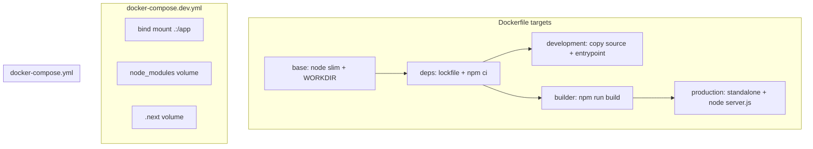

# پلن قابل‌استفاده‌مجدد: داکرایز + Compose (Prod / Dev)

> **مرجع پیاده‌سازی:** همین repo — [`Dockerfile`](../Dockerfile)، [`docker-compose.yml`](../docker-compose.yml)، [`docker-compose.dev.yml`](../docker-compose.dev.yml)  
> **هدف:** وقتی همین پلن را در پروژهٔ دیگری اجرا می‌کنید، **نام و نقش فایل‌ها ثابت** بماند؛ فقط مقادیر (Node version، پورت، دستور build/dev) با stack آن پروژه عوض شود.

---

## اصول طراحی

| اصل | توضیح |
|-----|--------|
| **یک Dockerfile، چند target** | `development` و `production` از یک فایل — بدون Dockerfile جدا |
| **Prod = پیش‌فرض Compose** | `docker compose up` بدون `-f` = پروداکشن |
| **Dev = فایل جدا** | `docker compose -f docker-compose.dev.yml up` |
| **Secrets خارج image** | `.env` در image کپی نشود؛ فقط `env_file` در compose |
| **Lockfile اجباری** | `npm ci` / `pnpm install --frozen` در stage `deps` |
| **Non-root در prod** | کاربر سیستمایی (مثلاً `nextjs`) فقط در target `production` |

---

## ساختار فایل‌های استاندارد (کپی به هر پروژه)

```text
project-root/
├── Dockerfile                 # multi-stage: base → deps → development | builder → production
├── docker-entrypoint.dev.sh   # npm ci اگر node_modules volume خالی بود
├── .dockerignore
├── docker-compose.yml         # PRODUCTION (default)
├── docker-compose.dev.yml     # DEVELOPMENT (hot reload)
├── docker-compose.prod.yml    # اختیاری: alias همان prod برای اسکریپت‌های قدیمی
├── .env.example               # بدون secret؛ برای compose env_file
└── README.md                  # بخش Docker (دستورات dev/prod)
```

---

## جریان build (Next.js / Node frontend)



---

## فاز ۰ — ممیزی پروژهٔ هدف (قبل از کپی فایل‌ها)

چک‌لیست را پر کنید:

| سؤال | nibmarket (نمونه) | پروژهٔ جدید |
|------|-------------------|-------------|
| Runtime | Node 22 LTS | ? |
| Package manager | npm + `package-lock.json` | npm / pnpm / yarn |
| فریم‌ورک | Next.js 16 App Router | Next / Vite / Express / … |
| پورت اپ | 3000 | ? |
| دستور dev | `npm run dev` | ? |
| دستور build | `npm run build` | ? |
| دستور prod | `node server.js` (standalone) یا `npm start` | ? |
| خروجی production | `output: 'standalone'` در `next.config` | ? |

**اگر Next.js نیست:** بخش [تطبیق stack](#تطبیق-برای-stackهای-دیگر) را ببینید.

---

## فاز ۱ — `Dockerfile` (الگوی چندمرحله)

### ۱.۱ آرگومان‌های قابل تنظیم (بالای فایل)

```dockerfile
# بدون # syntax=docker/dockerfile:1  → کمتر وابسته به auth.docker.io
ARG NODE_BASE_IMAGE=node:22-bookworm-slim
FROM ${NODE_BASE_IMAGE} AS base
WORKDIR /app
ENV NEXT_TELEMETRY_DISABLED=1   # اگر Next — وگرنه حذف
```

**شبکه سازمانی:** در `.env` پروژه:

```env
NODE_BASE_IMAGE=public.ecr.aws/docker/library/node:22-bookworm-slim
```

Compose هر دو فایل باید `build.args.NODE_BASE_IMAGE` را پاس دهند.

### ۱.۲ Stageها (ثابت — نام targetها عوض نشود)

| Stage | نقش | دستور کلیدی |
|-------|-----|-------------|
| `base` | تصویر پایه + WORKDIR | — |
| `deps` | وابستگی‌های reproducible | `COPY package*.json` + `npm ci` |
| `development` | dev container | `COPY . .` + entrypoint + `CMD npm run dev -- --hostname 0.0.0.0 --port PORT` |
| `builder` | build production artifacts | `ENV NODE_ENV=production` + `npm run build` |
| `production` | runtime minimal | کپی `standalone` + `static` + `public`؛ `USER` غیر root؛ `CMD node server.js` |

### ۱.۳ Next.js — الزامات `production` target

در `next.config.js` (یا `.ts`):

```js
const nextConfig = {
  output: 'standalone',
  // ...
}
```

در `production` stage (مثل nibmarket):

```dockerfile
COPY --from=builder /app/public ./public
COPY --from=builder --chown=nextjs:nodejs /app/.next/standalone ./
COPY --from=builder --chown=nextjs:nodejs /app/.next/static ./.next/static
ENV HOSTNAME=0.0.0.0
ENV PORT=3000
CMD ["node", "server.js"]
```

**اگر standalone ممکن نیست:** `production` → `CMD ["npm", "run", "start"]` و کل `.next` + `node_modules` production را کپی کنید (image بزرگ‌تر).

### ۱.۴ `docker-entrypoint.dev.sh`

```sh
#!/bin/sh
set -e
if [ ! -f node_modules/.bin/<binary> ]; then   # next / vite / nest
  echo "[docker] Installing dependencies..."
  npm ci
fi
exec "$@"
```

`<binary>` را با CLI فریم‌ورک عوض کنید.

---

## فاز ۲ — Compose

### ۲.۱ `docker-compose.yml` — **Production (پیش‌فرض)**

```yaml
services:
  app:
    build:
      context: .
      target: production
      args:
        NODE_BASE_IMAGE: ${NODE_BASE_IMAGE:-node:22-bookworm-slim}
    ports:
      - "${APP_PORT:-3000}:3000"
    env_file:
      - .env
    restart: unless-stopped
```

- **بدون volume روی سورس** — image خودکفا
- `docker compose up --build -d`

### ۲.۲ `docker-compose.dev.yml` — **Development**

```yaml
services:
  app:
    build:
      context: .
      dockerfile: Dockerfile
      target: development
      args:
        NODE_BASE_IMAGE: ${NODE_BASE_IMAGE:-node:22-bookworm-slim}
    ports:
      - "${APP_PORT:-3000}:3000"
    volumes:
      - .:/app
      - node_modules:/app/node_modules
      - app_cache:/app/.next          # Next — برای Vite: .vite یا dist
    env_file:
      - .env
    environment:
      CHOKIDAR_USEPOLLING: "true"      # macOS / Docker Desktop
      WATCHPACK_POLLING: "true"        # Next webpack watcher

volumes:
  node_modules:
  app_cache:
```

- `docker compose -f docker-compose.dev.yml up --build`
- اولین اجرا: entrypoint ممکن است `npm ci` بزند (چند دقیقه)

### ۲.۳ `docker-compose.prod.yml` (اختیاری)

فقط duplicate از `docker-compose.yml` یا کامنت «استفاده از `docker compose up`» — برای CI/اسکریپت‌هایی که `-f docker-compose.prod.yml` دارند.

### ۲.۴ قرارداد نام‌گذاری

| دستور | معنی |
|--------|------|
| `docker compose up --build` | Prod |
| `docker compose -f docker-compose.dev.yml up --build` | Dev |
| `docker compose down -v` | Dev — پاک کردن volumeهای node_modules/cache |

---

## فاز ۳ — `.dockerignore`

حداقل این موارد (از nibmarket):

```gitignore
node_modules
.next
out
.git
.env
.env.*
!.env.example
coverage
.DS_Store
```

**نکته:** `.npmrc` / `.pnpmfile.cjs` را **حذف نکنید** اگر برای `npm ci` لازم است.

---

## فاز ۴ — Env و مستندات

### ۴.۱ `.env` / `.env.example`

```env
# Docker build (اختیاری)
NODE_BASE_IMAGE=node:22-bookworm-slim
APP_PORT=3000

# اپ — مثل قبل
NEXT_PUBLIC_...
```

### ۴.۲ README — بلوک استاندارد (کپی)

```markdown
## Docker

**Production:** `docker compose up --build -d` → http://localhost:3000

**Development:** `docker compose -f docker-compose.dev.yml up --build`

Secrets in `.env` (not committed). Use `.env.local` for tokens.
```

---

## تطبیق برای stackهای دیگر

| Stack | `development` CMD | `builder` | `production` CMD | volume cache |
|-------|-------------------|-----------|------------------|--------------|
| **Next.js** (این پلن) | `npm run dev -- --hostname 0.0.0.0` | `npm run build` | `node server.js` | `.next` |
| **Vite + Node API جدا** | دو service در compose | `npm run build` (frontend) | `nginx` یا `node` static | `dist` |
| **Express / Nest** | `npm run dev` / `nest start --watch` | `npm run build` | `node dist/main.js` | — |
| **Python FastAPI** | Dockerfile جدا؛ همان **دو فایل compose** با target dev/prod | — | `uvicorn` | `__pycache__` ignore |

**قانون:** حتی با stack متفاوت، **نام فایل‌ها** (`docker-compose.yml` = prod، `docker-compose.dev.yml` = dev) حفظ شود.

---

## فاز ۵ — چک‌لیست پذیرش در پروژهٔ جدید

1. [ ] ممیزی stack (فاز ۰)
2. [ ] کپی `Dockerfile` + تنظیم `ARG` / پورت / دستورات npm
3. [ ] اگر Next: `output: 'standalone'` + تست `npm run build` لوکال
4. [ ] کپی `docker-entrypoint.dev.sh` + `chmod +x`
5. [ ] کپی `.dockerignore`
6. [ ] کپی `docker-compose.yml` + `docker-compose.dev.yml`
7. [ ] `.env.example` + README
8. [ ] `docker compose -f docker-compose.dev.yml up --build` → HMR کار کند
9. [ ] `docker compose up --build -d` → prod بدون mount سورس
10. [ ] CI (اختیاری): `docker compose build` در pipeline

---

## عیب‌یابی رایج

| مشکل | راه‌حل |
|------|--------|
| `auth.docker.io` timeout | `NODE_BASE_IMAGE=public.ecr.aws/docker/library/node:22-bookworm-slim`؛ حذف syntax directive |
| dev: `node_modules` خالی | entrypoint `npm ci`؛ volume `node_modules` |
| dev: HMR کار نمی‌کند | `CHOKIDAR_USEPOLLING` / `WATCHPACK_POLLING` |
| prod: `server.js` not found | `output: 'standalone'` و کپی مسیر `.next/standalone` |
| env در runtime نیست | `env_file: .env` در compose؛ rebuild بعد از تغییر `NEXT_PUBLIC_*` |

---

## تفاوت Prod vs Dev (خلاصه)

| | **Production** (`docker-compose.yml`) | **Development** (`docker-compose.dev.yml`) |
|---|----------------------------------------|---------------------------------------------|
| Build target | `production` | `development` |
| سورس | داخل image | bind mount `.:/app` |
| `node_modules` | داخل image | named volume |
| Build output cache | داخل image | volume (`.next` / …) |
| فرآیند | `node server.js` | `npm run dev` |
| restart | `unless-stopped` | default |
| اندازه image | کوچک (standalone) | بزرگ‌تر (شامل devDeps) |

---

## نگاشت به nibmarket (الان)

| فایل | وضعیت در nibmarket |
|------|---------------------|
| `Dockerfile` | ✅ deps / development / builder / production |
| `docker-compose.yml` | ✅ prod پیش‌فرض |
| `docker-compose.dev.yml` | ✅ dev + volumes |
| `docker-compose.prod.yml` | ✅ alias |
| `docker-entrypoint.dev.sh` | ✅ |
| `.dockerignore` | ✅ |
| `next.config.js` `output: 'standalone'` | ✅ |

پروژهٔ جدید: **همین فایل‌ها را کپی کنید** → فقط ستون «پروژهٔ جدید» در فاز ۰ را پر کنید و در Dockerfile/compose پورت و دستورات را به‌روز کنید.

---

## پیشنهاد گام بعد (خارج از این repo)

- استخراج به **Skill** یا **قالب repo** (`templates/docker/*`) برای `cursor init` در پروژهٔ بعدی
- اضافه کردن **healthcheck** در compose prod: `wget -qO- http://127.0.0.1:3000/api/health` (اگر route دارید)
- **CI**: `docker compose build` + push به registry سازمانی
