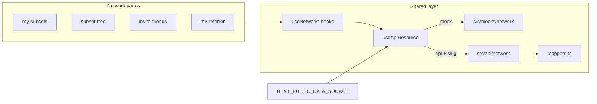

# پلن: Schema + اتصال API بخش شبکه من

## محدوده

چهار مسیر زیر منوی **شبکه من** ([`src/navigation/vertical/index.ts`](src/navigation/vertical/index.ts)):

| مسیر | صفحه | داده فعلی |
|------|------|-----------|
| `/network/my-subsets` | [`src/app/network/my-subsets/page.tsx`](src/app/network/my-subsets/page.tsx) | `tableRows` (DataGrid) |
| `/network/subset-tree` | [`src/app/network/subset-tree/page.tsx`](src/app/network/subset-tree/page.tsx) | `rootNode` (`NetworkNode`) |
| `/network/invite-friends` | [`src/app/network/invite-friends/page.tsx`](src/app/network/invite-friends/page.tsx) | `FUNDS`, `invitedUsers`, `referralCode`, سهمیه ماهانه |
| `/network/my-referrer` | [`src/app/network/my-referrer/page.tsx`](src/app/network/my-referrer/page.tsx) | فرم + mock `referrerInfo` |

**خارج از فاز:** `/invite` عمومی، `/reports/subsets`، `/leaderboard/*` (مگر بعداً درخواست شود).

**منبع حقیقت schema:** mockهای همین صفحات — نه [`docs/schema.md`](docs/schema.md) داشبورد. فایل جدید: **`docs/schema.network.md`**.

---

## جریان داده (مثل داشبورد)

---

## فاز ۱ — مستندسازی [`docs/schema.network.md`](docs/schema.network.md)

ساختار آینه [`docs/schema.md`](docs/schema.md): فهرست slug، TypeScript types، نمونه JSON از UI فعلی، endpoint پیشنهادی.

### Slugها و endpointهای پیشنهادی

| slug | صفحه | Method | Endpoint پیشنهادی |
|------|------|--------|---------------------|
| `network-subsets` | my-subsets | GET | `/api/network/subsets` |
| `network-subset-tree` | subset-tree | GET | `/api/network/subset-tree` |
| `network-invite` | invite-friends (بارگذاری اولیه) | GET | `/api/network/invite` |
| `network-referrer` | my-referrer (وضعیت) | GET | `/api/network/referrer` |
| — | my-referrer (ثبت کد) | POST | `/api/network/referrer` |
| — | invite-friends (ارسال دعوت) | POST | `/api/network/invite` |

### Types اصلی (استخراج از صفحات)

- **Subsets table** — از `TableRowType` در my-subsets: `id`, `fullName`, `level`, `joinDate`, `subMembersCount`, `leaderboardRank`, `avatar`
- **Subset tree** — از `NetworkNode`: `id`, `name`, `family`, `balance`, `networks[]` (تو در تو)
- **Invite page** — از invite-friends: `FundData`, `recentInvites[]`, `referralCode`, `maxInvitesPerMonth`, `remainingInvites`
- **Referrer** — از my-referrer: `hasSubsets`, `referrer` (`firstName`, `lastName`, `usedDate`) یا `null`

**یادداشت در schema:** `GET /api/dashboard/invites` ([`CrmAward`](src/views/dashboards/crm/CrmAward.tsx)) فقط خلاصه داشبورد است؛ صفحه دعوت کامل‌تر است — در فاز ۱ جدا نگه داشته می‌شود.

### به‌روزرسانی [`docs/DATA_SOURCE.md`](docs/DATA_SOURCE.md) و [`.env.example`](.env.example)

- لینک به `schema.network.md`
- گسترش `NEXT_PUBLIC_API_ENABLED` برای slugهای `network-*` (همان الگو: خالی = همه در حالت `api`)

---

## فاز ۲ — زیرساخت مشترک

### ۱. Config — [`src/configs/data-source.ts`](src/configs/data-source.ts)

- اضافه کردن `NetworkEndpointSlug` و `ALL_NETWORK_SLUGS`
- `ApiEndpointSlug = DashboardEndpointSlug | NetworkEndpointSlug`
- `shouldUseApiForEndpoint(slug)` برای هر دو نوع
- پارس `NEXT_PUBLIC_API_ENABLED`: پشتیبانی از slugهای `network-*` در کنار `dashboard-*`

### ۲. Generalize hook — [`src/hooks/dashboard/useApiResource.ts`](src/hooks/dashboard/useApiResource.ts)

- تغییر نوع `slug` به `ApiEndpointSlug` (یا انتقال به `src/hooks/useApiResource.ts` و re-export از dashboard)
- رفتار فعلی حفظ شود: `loading` / `retrying` / `hasData` / `refetch` با قفل تک‌درخواستی، پیام فارسی شبکه

### ۳. Types — `src/types/api/network.ts`

انواع مطابق `schema.network.md`.

### ۴. Mock مرکزی — `src/mocks/network/index.ts`

انتقال mock از صفحات به یک ماژول (همان مقادیر فعلی UI).

### ۵. API clients — `src/api/network/*.ts`

- `subsets.ts`, `subset-tree.ts`, `invite.ts`, `referrer.ts`
- استفاده از [`src/lib/api-client.ts`](src/lib/api-client.ts) + Bearer موجود

### ۶. Mappers — `src/lib/network/mappers.ts`

- `unwrapPayload({ data })`
- نرمال‌سازی اعداد/رشته‌ها (الگوی [`src/lib/dashboard/mappers.ts`](src/lib/dashboard/mappers.ts))
- fallback به `src/mocks/network` در map، نه نمایش mock در UI هنگام خطا

### ۷. Hooks — `src/hooks/network/*.ts`

| Hook | slug |
|------|------|
| `useNetworkSubsets` | `network-subsets` |
| `useNetworkSubsetTree` | `network-subset-tree` |
| `useNetworkInvite` | `network-invite` |
| `useNetworkReferrer` | `network-referrer` |

### ۸. Mutations (جدا از `useApiResource`)

- `submitReferrerCode(code)` → POST `/api/network/referrer`
- `sendNetworkInvite(payload)` → POST `/api/network/invite`

در حالت `mock`: همان رفتار فعلی (toast + state محلی). در `api`: فراخوانی واقعی + خطای فارسی روی دکمه/فرم بدون ریختن layout.

---

## فاز ۳ — اتصال UI (حفظ اسکلت + خطا مثل داشبورد)

الگوی [`DashboardWidgetState`](src/components/dashboard/DashboardWidgetState.tsx): skeleton فقط بار اول؛ در خطا overlay روی همان layout + «تلاش مجدد»؛ `WidgetField` برای مقادیر حساس.

### پیشنهاد refactor سبک

استخراج محتوا به `src/views/network/` (اختیاری ولی هم‌راستا با `src/views/dashboards/crm/`):

| View | مسئولیت |
|------|---------|
| `NetworkSubsetsTable.tsx` | DataGrid + جستجو |
| `NetworkSubsetTreeView.tsx` | `NetworkTree` |
| `NetworkInviteFriendsView.tsx` | Stepper + لیست اخیر |
| `NetworkMyReferrerView.tsx` | فرم + کارت معرف |

صفحات `app/network/*/page.tsx` فقط `Suspense` + import view.

### per-page wiring

**my-subsets:** یک `DashboardWidgetState` دور DataGrid؛ `hasData` برای سلول‌ها / skeleton ردیف.

**subset-tree:** یک widget دور `NetworkTree`؛ در خطا درخت با placeholder/skeleton نام‌ها (بدون mock مبلغ واقعی).

**invite-friends:**
- GET یک‌جا (`useNetworkInvite`) برای funds، recent، code، quota
- بخش «دعوت شدگان اخیر» همان overlay/error
- Stepper و فرم در حالت خطا visible با فیلدهای غیرفعال یا skeleton
- POST ارسال دعوت: mutation جدا؛ quota از پاسخ API بعد از موفقیت به‌روز شود (جایگزین localStorage تدریجی در حالت api)

**my-referrer:**
- GET `useNetworkReferrer` برای `hasSubsets` + `referrerInfo`
- POST روی submit؛ دکمه loading/error محلی

---

## فاز ۴ — تست دستی

| حالت env | انتظار |
|----------|--------|
| `DATA_SOURCE=mock` | UI فعلی، بدون تغییر ظاهری |
| `DATA_SOURCE=api` + `API_ENABLED` خالی | همه `network-*` از API؛ خطا → overlay فارسی + retry یک‌بار |
| `API_ENABLED=network-subsets` | فقط جدول API؛ بقیه mock |

---

## فایل‌های کلیدی

| نقش | مسیر |
|-----|------|
| Schema (جدید) | `docs/schema.network.md` |
| Env / راهنما | `docs/DATA_SOURCE.md`, `.env.example` |
| Slugها | `src/configs/data-source.ts` |
| Hook | `src/hooks/useApiResource.ts` (عمومی‌شده) |
| Mock | `src/mocks/network/index.ts` |
| API | `src/api/network/*` |
| Map | `src/lib/network/mappers.ts` |
| UI state | `DashboardWidgetState`, `WidgetField` (موجود) |

---

## وابستگی به بک‌اند

فاز ۱ فقط **قرارداد پیشنهادی** است. تا وقتی API واقعی آماده نشود، `DATA_SOURCE=mock` رفتار فعلی را حفظ می‌کند؛ با `api` mapperها همان شکل mock را از پاسخ بک‌اند نرمال می‌کنند.

اگر بعداً مسیرهای واقعی Swagger متفاوت بود، فقط `src/api/network/*` و بخش endpoint در `schema.network.md` عوض می‌شود — slugهای env ثابت می‌مانند.
