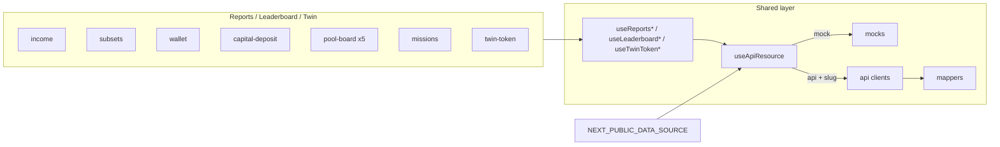

# پلن: Schema + اتصال API — گزارش، لیدر بورد، توکن TWIN

> الگوی مرجع: [network_api_integration_0718809a.plan.md](./network_api_integration_0718809a.plan.md) (تکمیل‌شده) و داشبورد CRM.

---

## محدوده

### داخل فاز (منوی کاربر + TWIN مدیر)

منبع منو: [`src/navigation/vertical/index.ts`](src/navigation/vertical/index.ts)

| منو | مسیر | صفحه / کامپوننت | داده فعلی (mock) |
|-----|------|-----------------|------------------|
| **گزارش** | `/reports/income` | [`src/app/reports/income/page.tsx`](src/app/reports/income/page.tsx) | `transactions[]` در `useMemo` |
| | `/reports/subsets` | [`src/app/reports/subsets/page.tsx`](src/app/reports/subsets/page.tsx) | `subsetReports[]` |
| | `/reports/wallet` | [`src/app/reports/wallet/page.tsx`](src/app/reports/wallet/page.tsx) | `allTransactions[]` + فیلتر تاریخ/نوع |
| | `/capital-deposit` | [`src/app/capital-deposit/page.tsx`](src/app/capital-deposit/page.tsx) | `FUNDS` + `generateMockFundData()` + آمار مشتق |
| **لیدر بورد** | `/leaderboard/pool-board` | [`src/app/leaderboard/pool-board/page.tsx`](src/app/leaderboard/pool-board/page.tsx) | ۵ ویجت در `src/views/dashboards/pool-board/*` |
| | `/leaderboard/missions` | [`src/app/leaderboard/missions/page.tsx`](src/app/leaderboard/missions/page.tsx) | [`src/data/missions.ts`](src/data/missions.ts) |
| **توکن TWIN** (مدیر) | `/manager/twin-token` | [`src/app/manager/twin-token/page.tsx`](src/app/manager/twin-token/page.tsx) | `generateMockTwinTokenData()` + chart داخل `TokenPriceChart` |

### خارج از فاز

- **شبکه من** (`/network/*`) — انجام شده → [`docs/schema.network.md`](../docs/schema.network.md)
- **داشبورد CRM** (`/dashboard`) — انجام شده → [`docs/schema.md`](../docs/schema.md)
- **مسابقه** (`/competition/*`)
- **مدیر:** داشبورد، استخر، کاربران، `capital-deposit` مدیر (`/manager/capital-deposit`)
- **`/invite` عمومی**

### تفکیک مهم با داشبورد

| داده | slug داشبورد | صفحه کامل این پلن |
|------|--------------|-------------------|
| خلاصه لیدربورد ویجت CRM | `dashboard-leaderboard` → `CrmProjectTimeline` | — |
| استخر + ۴ بورد + افتخارات | — | `/leaderboard/pool-board` (۵ slug جدا) |
| گزارش درآمد/کیف پول | — | `/reports/*` |

تا زمان آماده شدن API بک‌اند، slugها و mapperها جدا می‌مانند؛ تداخل UI نیست.

---

## جریان داده (مثل شبکه)



---

## فاز ۱ — مستندسازی Schema (۳ فایل)

ساختار آینه [`docs/schema.network.md`](../docs/schema.network.md): slug، types، JSON نمونه از UI فعلی، endpoint پیشنهادی، یادداشت mapper.

### ۱.۱ [`docs/schema.reports.md`](../docs/schema.reports.md)

| slug | صفحه | Method | Endpoint پیشنهادی | Query |
|------|------|--------|---------------------|-------|
| `reports-income` | income | GET | `/api/reports/income` | `year`, `month` (شمسی) |
| `reports-subsets` | subsets | GET | `/api/reports/subsets` | `year`, `month` |
| `reports-wallet` | wallet | GET | `/api/reports/wallet` | `startDate`, `endDate`, `type` (`all` \| `deposit` \| `withdraw`) |
| `reports-capital-deposit` | capital-deposit | GET | `/api/reports/capital-deposit` | — |

**Types (استخراج از صفحات):**

```ts
// income
type IncomeTransaction = { id: string; date: string; type: 'فعالیت در سامانه' | 'توسعه شبکه' | 'پورسانت'; description: string }
type ReportsIncomeResponse = { rows: IncomeTransaction[] }

// subsets
type SubsetReportRow = {
  id: string; rowNumber: number; fullName: string; joinDate: string; level: number
  lastMonthAvgInvestment: number; lastMonthReward: number
  currentMonthAvgInvestment: number; totalReward: number
}
type ReportsSubsetsResponse = { rows: SubsetReportRow[] }

// wallet
type WalletTransaction = { id: string; date: string; type: 'واریز' | 'برداشت'; description: string }
type ReportsWalletResponse = { rows: WalletTransaction[] }

// capital-deposit (همان شکل FundDistribution)
type CapitalDepositFund = { id: string; name: string; symbol: string; category: string; investors: number; capital: number; percentage: number }
type ReportsCapitalDepositResponse = {
  funds: CapitalDepositFund[]
  statistics: { totalInvestors: number; totalCapital: number; firstInvestorsCapital: number; networkCapital: number }
}
```

**یادداشت:** فیلتر سال/ماه در UI الان فقط `console.log` است — در فاز ۳ `handleSearch` باید `refetch` با query به hook وصل شود (mock: فیلتر سمت کلاینت روی همان آرایه mock تا API آماده شود).

---

### ۱.۲ [`docs/schema.leaderboard.md`](../docs/schema.leaderboard.md)

صفحه `pool-board` مثل داشبورد CRM: **یک slug per widget** برای خطای ایزوله.

| slug | ویجت | فایل mock | Endpoint پیشنهادی |
|------|------|-----------|---------------------|
| `leaderboard-pool-balance` | `PoolBalance` | [`PoolBalance.tsx`](../src/views/dashboards/pool-board/PoolBalance.tsx) | `GET /api/leaderboard/pool-balance` |
| `leaderboard-current-month` | `CurrentMonthLeaderboard` | [`CurrentMonthLeaderboard.tsx`](../src/views/dashboards/pool-board/CurrentMonthLeaderboard.tsx) | `GET /api/leaderboard/current-month` |
| `leaderboard-my-subsets` | `MySubsetsLeaderboard` | [`MySubsetsLeaderboard.tsx`](../src/views/dashboards/pool-board/MySubsetsLeaderboard.tsx) | `GET /api/leaderboard/my-subsets` |
| `leaderboard-last-month` | `LastMonthLeaderboard` | [`LastMonthLeaderboard.tsx`](../src/views/dashboards/pool-board/LastMonthLeaderboard.tsx) | `GET /api/leaderboard/last-month` |
| `leaderboard-honors` | `HonorsShowcase` | [`HonorsShowcase.tsx`](../src/views/dashboards/pool-board/HonorsShowcase.tsx) | `GET /api/leaderboard/honors` |
| `leaderboard-missions` | missions grid | [`src/data/missions.ts`](../src/data/missions.ts) | `GET /api/leaderboard/missions` |

**Types نمونه:**

```ts
// pool balance
type PoolBalanceResponse = { poolBalance: number; participantsCount: number; monthlyChangePercent: number }

// leaderboard rows (سه بورد مشترک)
type LeaderboardEntry = { id: number; rank: number; name: string; points: number; subordinates: number }
type LeaderboardListResponse = { entries: LeaderboardEntry[] }

// honors
type HonorItem = { id: number; title: string; icon: string; color: string; description: string; count: number; totalPoints: number }
type HonorsResponse = { honors: HonorItem[] }

// missions
type Mission = { id: number; title: string; completed: boolean; reward: string }
type MissionsResponse = { missions: Mission[] }
```

**POST (اختیاری — فاز بعد):** تکمیل ماموریت (`POST /api/leaderboard/missions/:id/complete`) — UI فعلاً فقط `console.log`؛ در فاز ۱ فقط GET مستند شود.

---

### ۱.۳ [`docs/schema.twin-token.md`](../docs/schema.twin-token.md)

مسیر مدیر؛ slug با پیشوند `manager-` برای تمایز از client.

| slug | بخش | Method | Endpoint پیشنهادی |
|------|-----|--------|---------------------|
| `manager-twin-stats` | `TwinTokenStatistics` | GET | `/api/manager/twin-token/stats` |
| `manager-twin-price-chart` | `TokenPriceChart` | GET | `/api/manager/twin-token/price-history` |

**Types:**

```ts
type TwinTokenStatsResponse = {
  poolBalance: number       // ریال
  totalTokens: number
  circulatingTokens: number
  tokenPrice: number        // ریال per token
  priceChange24h: number    // درصد
  burnedTokens: number
}

type TwinPriceCandle = { x: number; y: [open, high, low, close] }
type TwinPriceChartResponse = { candles: TwinPriceCandle[]; currentPrice: number; priceChange24h: number }
```

منبع mock: [`generateMockTwinTokenData`](src/app/manager/twin-token/page.tsx) + `generateMockPriceData` در [`TokenPriceChart.tsx`](../src/views/dashboards/manager/twin-token/TokenPriceChart.tsx) → انتقال به `src/mocks/twin-token/index.ts`.

---

### ۱.۴ به‌روزرسانی [`docs/DATA_SOURCE.md`](../docs/DATA_SOURCE.md) و [`.env.example`](../.env.example)

- لینک به سه schema جدید
- جدول slugهای `reports-*`, `leaderboard-*`, `manager-twin-*`
- نمونه: `NEXT_PUBLIC_API_ENABLED=reports-income,leaderboard-pool-balance`

---

## فاز ۲ — زیرساخت مشترک

### ۲.۱ Config — [`src/configs/data-source.ts`](../src/configs/data-source.ts)

```ts
export type ReportsEndpointSlug = 'reports-income' | 'reports-subsets' | 'reports-wallet' | 'reports-capital-deposit'
export type LeaderboardEndpointSlug = 'leaderboard-pool-balance' | 'leaderboard-current-month' | 'leaderboard-my-subsets' | 'leaderboard-last-month' | 'leaderboard-honors' | 'leaderboard-missions'
export type ManagerTwinEndpointSlug = 'manager-twin-stats' | 'manager-twin-price-chart'

export type ApiEndpointSlug =
  | DashboardEndpointSlug
  | NetworkEndpointSlug
  | ReportsEndpointSlug
  | LeaderboardEndpointSlug
  | ManagerTwinEndpointSlug
```

- `ALL_REPORTS_SLUGS`, `ALL_LEADERBOARD_SLUGS`, `ALL_MANAGER_TWIN_SLUGS`
- گسترش `ALL_API_SLUGS` و پارس `NEXT_PUBLIC_API_ENABLED`

### ۲.۲ Types

- [`src/types/api/reports.ts`](../src/types/api/reports.ts)
- [`src/types/api/leaderboard.ts`](../src/types/api/leaderboard.ts)
- [`src/types/api/twin-token.ts`](../src/types/api/twin-token.ts)

### ۲.۳ Mock مرکزی

| ماژول | محتوا |
|--------|--------|
| [`src/mocks/reports/index.ts`](../src/mocks/reports/index.ts) | آرایه‌های فعلی income/subsets/wallet + capital-deposit ثابت (بدون random در mock پایه؛ optional seed برای dev) |
| [`src/mocks/leaderboard/index.ts`](../src/mocks/leaderboard/index.ts) | داده‌های ۵ فایل pool-board + `missionsData` |
| [`src/mocks/twin-token/index.ts`](../src/mocks/twin-token/index.ts) | stats + candles ثابت (جایگزین `Math.random` در chart برای UI پایدار) |

### ۲.۴ API clients — `src/api/reports/*`, `src/api/leaderboard/*`, `src/api/manager/twin-token/*`

- `apiClient` + Bearer ([`src/lib/api-client.ts`](../src/lib/api-client.ts))
- query params برای فیلتر گزارش‌ها

### ۲.۵ Mappers — `src/lib/reports/mappers.ts`, `src/lib/leaderboard/mappers.ts`, `src/lib/twin-token/mappers.ts`

- `unwrapPayload({ data })`
- نرمال اعداد، کلیدهای جایگزین (`entries` / `rows` / `items`)
- **fallback فقط در mapper** هنگام map — نه نمایش mock در UI هنگام خطای API (همان قانون داشبورد/شبکه)

### ۲.۶ Hooks

**Reports** (`src/hooks/reports/`):

| Hook | slug | deps |
|------|------|------|
| `useReportsIncome` | `reports-income` | `year`, `month` |
| `useReportsSubsets` | `reports-subsets` | `year`, `month` |
| `useReportsWallet` | `reports-wallet` | `startDate`, `endDate`, `type` |
| `useReportsCapitalDeposit` | `reports-capital-deposit` | — |

**Leaderboard** (`src/hooks/leaderboard/`): یک hook per slug (مثل `useLeaderboardPoolBalance`, …, `useLeaderboardMissions`).

**Twin** (`src/hooks/manager/`): `useTwinTokenStats`, `useTwinTokenPriceChart`.

همه از [`useApiResource`](../src/hooks/useApiResource.ts) با `slug: ApiEndpointSlug` گسترش‌یافته.

---

## فاز ۳ — اتصال UI

الگوی [`DashboardWidgetState`](../src/components/dashboard/DashboardWidgetState.tsx) + [`WidgetField`](../src/components/dashboard/WidgetField.tsx) (در صورت نیاز برای اعداد).

### ۳.۱ گزارشات (۴ صفحه)

| صفحه | wiring |
|------|--------|
| **income** | `DashboardWidgetState` دور DataGrid؛ دکمه جستجو → `refetch` با سال/ماه؛ mock mode: فیلتر local روی `data.rows` |
| **subsets** | همان الگو |
| **wallet** | overlay روی جدول؛ فیلترها → refetch یا فیلتر mock |
| **capital-deposit** | ۳ بلوک: `FundStatistics` (یک widget)، `FundDistribution`، `FundCapitalChart` — یا یک slug با props مشتق (ترجیح: **یک slug** `reports-capital-deposit` و یک `DashboardWidgetState` دور کل Grid برای سادگی؛ در صورت نیاز به ایزوله‌سازی خطا بعداً split) |

**پیشنهاد refactor (اختیاری):** `src/views/reports/IncomeReportTable.tsx` و مشابه — صفحات `app/reports/*/page.tsx` فقط `Suspense` + import.

### ۳.۲ لیدر بورد

**`/leaderboard/pool-board`:**

- هر یک از ۵ کامپوننت در `src/views/dashboards/pool-board/` به **presentational** تبدیل شود: props `data` + بدون const mock داخلی.
- صفحه یا wrapper جدید `PoolBoardPage` هر Grid item را در `DashboardWidgetState` می‌پیچد.
- ۵ hook مستقل → خطای یک بورد، بقیه سالم.

**`/leaderboard/missions`:**

- یک `DashboardWidgetState` دور Grid ماموریت‌ها
- `useLeaderboardMissions`؛ کلیک ماموریت بدون POST تا API آماده شود

### ۳.۳ توکن TWIN (مدیر)

[`src/app/manager/twin-token/page.tsx`](../src/app/manager/twin-token/page.tsx):

- `TwinTokenStatistics` ← `useTwinTokenStats` + widget state
- `TokenPriceChart` ← `useTwinTokenPriceChart`؛ حذف `generateMockPriceData` از داخل chart؛ داده از props/hook
- دو overlay مستقل (stats vs chart)

---

## فاز ۴ — تست دستی

| حالت env | انتظار |
|----------|--------|
| `DATA_SOURCE=mock` | UI فعلی بدون تغییر ظاهری |
| `DATA_SOURCE=api` + `API_ENABLED` خالی | همه slugهای جدید از API |
| `API_ENABLED=reports-income,leaderboard-missions` | فقط آن دو از API؛ بقیه mock |
| خطای شبکه | overlay فارسی + «تلاش مجدد» یک‌بار؛ بدون mock روی layout |

چک‌لیست مسیر:

- [ ] `/reports/income`, `/reports/subsets`, `/reports/wallet`, `/capital-deposit`
- [ ] `/leaderboard/pool-board` (۵ ویجت)
- [ ] `/leaderboard/missions`
- [ ] `/manager/twin-token` (با نقش manager)

`npm run build` بدون خطای TypeScript.

---

## فایل‌های کلیدی (خلاصه)

| نقش | مسیر |
|-----|------|
| Schema گزارش | `docs/schema.reports.md` |
| Schema لیدربورد | `docs/schema.leaderboard.md` |
| Schema TWIN | `docs/schema.twin-token.md` |
| Slugها | `src/configs/data-source.ts` |
| Mock | `src/mocks/reports`, `leaderboard`, `twin-token` |
| API | `src/api/reports/*`, `leaderboard/*`, `manager/twin-token/*` |
| Hooks | `src/hooks/reports/*`, `leaderboard/*`, `manager/*` |
| UI state | `DashboardWidgetState`, `WidgetField` |

---

## ترتیب پیشنهادی اجرا (فازبندی PR)

1. **فقط schema + env** (۳ doc + data-source) — بدون تغییر UI
2. **گزارشات** (۴ صفحه، الگوی ساده مثل network-subsets)
3. **لیدر بورد pool-board** (بیشترین فایل — refactor ویجت‌ها)
4. **missions + twin-token**
5. تست دستی + `build`

---

## وابستگی بک‌اند

فاز ۱ قرارداد **پیشنهادی** است. تا API واقعی نباشد `DATA_SOURCE=mock` رفتار فعلی را حفظ می‌کند.

اگر Swagger مسیر دیگری داشت، فقط `src/api/*` و بخش endpoint در schema عوض می‌شود — **slugهای env ثابت** می‌مانند.

---

## آمار محدوده

| دسته | تعداد مسیر | تعداد slug API |
|------|------------|----------------|
| گزارش | 4 | 4 |
| لیدر بورد | 2 | 6 |
| توکن TWIN | 1 | 2 |
| **جمع** | **7** | **12** |

(در کنار ۱۰ slug موجود داشبورد + ۴ slug شبکه.)
